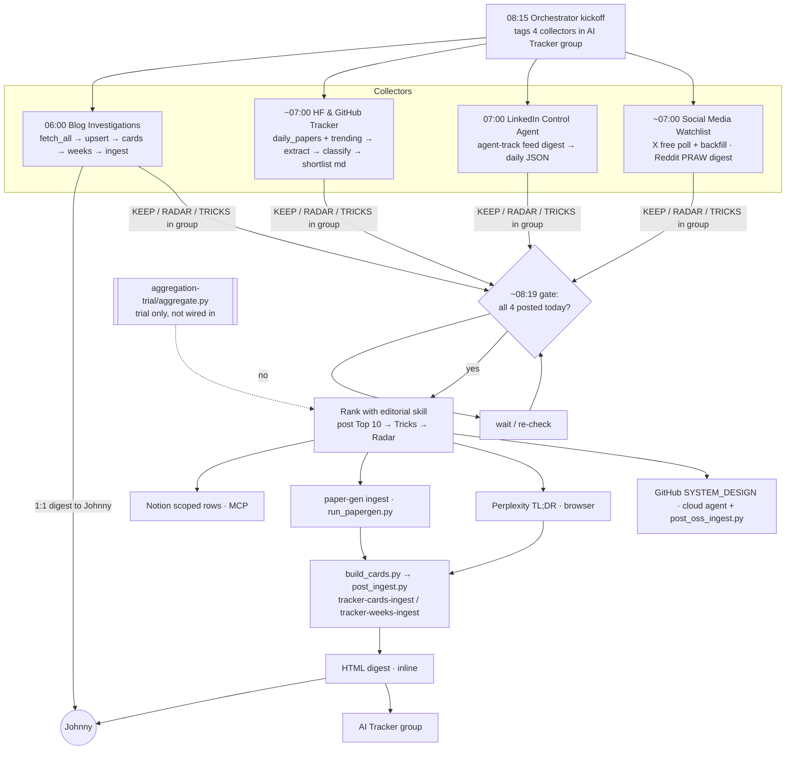

# AI Tracker daily pipeline (weekdays, HKT)

How the live bots run on weekdays. For the file-level catalog see [INVENTORY.md](INVENTORY.md); for observed weaknesses see [IMPROVEMENTS.md](IMPROVEMENTS.md). This repository is a source dump, not a runnable install.

| Time (HKT) | Bot | Step |
|---|---|---|
| 06:00 | Blog Investigations | Blog scan. Fetch tier-1/2 sources (`blog-investigations/daily-scan/fetch_all.py`), upsert sources, write cards, update the week pack, ingest to the tracker site, then send Johnny a 1:1 zh digest. It does not post to the group. Tier-3 sources need a browser pass (`tier3/`). |
| ~06:45–07:00 | Huggingface & Github Tracker | HF Daily Papers (`/api/daily_papers`) + GitHub Trending. Extract text (`tools/paper_extract.py`), classify topics (`tools/jev_topic_filter.py`), write `<date>-hf-daily-papers.md / -github-trending.md / -group-shortlist.md`, run the optional `paper_review` HTML. |
| 07:00 | Linkedln Control Agent | `agent-track feed digest`, about 20 feed posts, saved to `data/feed/daily/<date>.json`. Sends numbered suggestions to Johnny (Notion only when he asks). |
| ~07:00–07:11 | Social Media Watchlist | X watchlist poll using free reads with since_id, by-ID backfill (`x-watchlist/save_poll.py`, `merge_backfill.py`), plus the Reddit digest (`reddit-digest/build.py`). Posts KEEP / RADAR (+ TRICKS from 10-20) to the group. |
| 08:15 | Orchestrator | Kickoff routine `ai-tracker-weekday-highlights`. Tags all four collectors in the group and asks for KEEP / RADAR / TRICKS. |
| ~08:19 | Orchestrator | Gate routine `ai-tracker-weekday-top-10`. Waits until **all four** collectors have posted today, then ranks (editorial skill) and posts **Top 10 → Tricks & Ideas → Radar** once. |
| after the post | Orchestrator | Downstream, with no wait for clarifications: Notion rows (MCP) · paper-gen (`downstream/paper-gen/run_papergen.py`) · Perplexity TL;DR (browser session) · GitHub SYSTEM_DESIGN (cloud agent + `post_oss_ingest.py`) · cards + week (`build_cards.py`, `post_ingest.py`) · HTML digest to the group + Johnny. |
| Mon 09:10 | Blog Investigations | Weekly blog rollup. |

